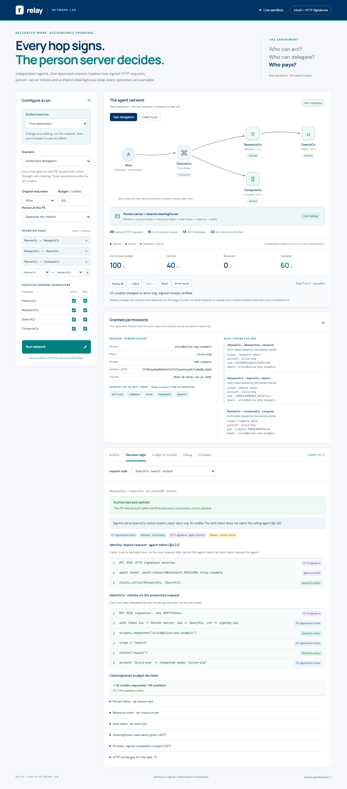

# Relay — AAuth network lab

[](https://github.com/darkedges/aauth-lab/actions/workflows/check.yml)

The [Relay Biscuit lab](https://github.com/darkedges/biscuit-trust-lab) rebuilt on [AAuth](https://datatracker.ietf.org/doc/html/draft-hardt-oauth-aauth-protocol). It has the same operators, scenarios, budget rules and UI. Biscuit attenuation is replaced by AAuth's signed HTTP requests, person-server tokens and call chaining. Signatures, tokens and HTTP exchanges are real. Operators, work and credits are simulated.

**Live demo:** [aauth.demos.darkedges.com](https://aauth.demos.darkedges.com)



See **[COMPARISON.md](COMPARISON.md)** for a side-by-side analysis of the two solutions.

## Run locally

Use Node.js 22 or newer and pnpm 11:

```sh
pnpm install
pnpm dev
```

Open **http://127.0.0.1:8796**. The Biscuit lab uses 8795, so both labs can run side by side. On Windows, run `./start.ps1`. The interface starts a demo run automatically.

```sh
pnpm check   # behaviour, spec-conformance, reference-client interop and debug formatting tests
```

## How the AAuth version works

Each run creates fresh Ed25519 keys and a fresh set of origins, such as `https://search.<tag>.relay.example`. Requests between parties are real `Request`/`Response` objects routed in-process to that run's handlers. Signing and verification use the official libraries:

- `@aauth/agent` (`createSignedFetch`) signs every request per RFC 9421, with `Signature-Key: sig=jwt;jwt="…"`.
- `@hellocoop/httpsig` (`verify`) verifies every request. PS endpoints require `content-digest`.
- `@aauth/resource` handles `verifyToken`, `createResourceToken` and the `AAuth-Requirement` headers.
- `jose` signs the tokens the person server mints.

```text
Alice ── approves mission (payer, budget, tools, resources) at ── Person server (PS)
  │                                                                  ▲  ▲  ▲
Assistant (Alice's agent)                                            │  │  │ person/auth tokens,
  └─ PlannerCo            ← auth token, aud=planner ────────────────┘  │  │ every hop, via
       ├─ ResearchCo [5]  ← auth token via call chaining ──────────────┘  │ upstream_token
       │    └─ SearchCo [10] ← auth token via call chaining ──────────────┘
       └─ ComputeCo [25]
All billable calls → Clearinghouse (a resource; reached by call chaining too)
```

Alice first connects the Assistant to her PS (simulated), and the Assistant proposes a mission (§8.1). Only Alice can approve it, so the PS answers `202` with `requirement=interaction`, an interaction URL, a code and a pending URL (§11.6.3). Alice opens the URL and approves (her browser session is simulated) while the Assistant polls the pending URL with signed `GET`s: `202 interacting`, then `200` (§11.8). The approval returns the mission blob, its `s256`, and a person token for PlannerCo (§8.2). Then every hop runs the same five-step exchange. It is the walkthrough from `AGENTS.md`, with call chaining added:

1. **Identity-based call.** The caller signs with its agent token, so the receiver learns *who* is calling from the signature alone. The receiver either rejects the caller (`403 denied`, caller trust, §4.2.1) or answers `401 AAuth-Requirement: requirement=person-token`. This is the only request in the flow that names the agent (§C.1.6).
2. **Person token.** The caller asks the PS for a person token for that receiver. An intermediary passes the token it was given as `upstream_token`. The PS verifies it per §9.4.5: it was issued by this PS, it is addressed to the signing intermediary, and the PS can identify the agent it was issued to. It then resolves the person and carries the mission forward.
3. **Resource token.** The caller presents the person token. The receiver answers `401 requirement=auth-token` with a resource token naming the scope (`search email`), the billing `account`, `agent_jkt` and `presented_jti`. The caller checks it per §6.7.3.
4. **Auth token.** The caller sends the resource token to the PS. The PS verifies it against the presented token per §6.7.2, including that `mission_s256` was not stripped. It then applies its supervision policy over the mission: the requested scope must be in the mission's `relay.scopes` for that resource, and the `account` must equal `relay.payer`. It mints an `aa-auth+jwt`, or refuses with `denied`.
5. **Authorized call.** The receiver verifies the auth token (JWKS, `aud`, `exp`, `cnf` equals the signing key), then applies local policy: accepted requester (the PS-vouched `email`), scope, offered action, and account. It then bills through the clearinghouse, using the same five steps.

The clearinghouse reads the mission from the PS and checks its `mission_s256`. It takes the payer from the auth token's PS-signed `account` claim. AAuth tokens do not name the calling agent, so each billing request carries a provider assertion: a JWT signed with the operator's agent-provider key and bound to the key signing the request. The clearinghouse keeps the same reservation, idempotency, release and signed-receipt rules as the Biscuit lab.

## Scenarios

| Scenario | Where AAuth stops it | Credits settled |
| --- | --- | ---: |
| Authorized delegation | — (40 signed requests, 16 to the PS, 2 of them consent polls) | 40 |
| Change payer | PS policy: `account "mallory-org" ≠ relay.payer` | 30 |
| Forbidden operation | PS policy: `relay.scopes[SearchCo] ∌ "delete"` (SearchCo does offer delete) | 30 |
| Untrusted issuer | SearchCo: forged auth token fails PS JWKS signature check | 30 |
| Competing reservations | Clearinghouse: `402` insufficient credits | 65 |
| Retry | Cached auth token reused; clearinghouse returns `duplicate: true` | 40 |
| Operation failure | Reservation released | 30 |
| Remove ResearchCo → SearchCo trust | SearchCo `403` on the agent-token call, before any PS call (an agent that skips that call is not identified; see COMPARISON.md) | 30 |
| SearchCo rejects Alice | SearchCo policy on the PS-vouched `email` claim | 30 |

## Live hop

`pnpm live` runs the Assistant's first hop twice: once in the lab, and once against real services, signing as the agent identity that `@aauth/bootstrap` set up (see `AGENTS.md`). It prints both exchange sequences, their request counts and the auth token claims side by side. The full live trace goes to `live/` (ignored by git; it holds your tokens and profile).

```sh
pnpm live                      # whoami.aauth.dev?scope=openid+profile
pnpm live -- --prompt-consent  # force the consent prompt, to see the 202 and polls
pnpm live -- --resource <url>
```

The lab's operators exist only inside one `/api/run`, so a real PS cannot address them: the live hop goes to `whoami.aauth.dev` instead of PlannerCo. `person.hello.coop` publishes no mission endpoint, so the live hop runs without a mission. It runs in Node only, because the signing key stays in your OS keychain.

## UI

The layout matches the Biscuit lab: guided exercises, replay, compare, ledger and export. AAuth-specific views:

- **Granted permissions** shows the approved mission held by the PS, and the auth token minted for each hop (`scope`, `account`, directed `sub`).
- **Decision logic** shows the identity-request check (caller trust), the PS mission evaluation (when the PS decided) and the receiver's checks. Each check is labelled with its source: PS-signed token, receiver policy, HTTP signature, or mission/PS policy.
- **Debug** lists every signed HTTP exchange in order, including the consent polls and the simulated person's steps at the PS, with real `Signature`, `Signature-Input` and `Signature-Key` headers, the decoded token presented, `AAuth-Requirement` challenges, and `--explain`-style summary and description narration. Key-discovery fetches are hidden by default.

## Deliberate simplifications

- **The person is simulated.** The consent exchange is real (`202`, interaction code, signed polls, `410` once done), but Alice's browser session at the PS is scripted: she opens the URL, then approves. Set **Person at the PS** to *Declines the mission* (or guided exercise 7, or `"consent": "decline"` on `/api/run`) to have her decline, which ends polling with `403 denied`. Auth-token requests under an approved mission are decided by PS policy at once; `person.hello.coop` answered that request with `202 requirement=approval` instead. COMPARISON.md lists where the live flow and the lab differ.
- **Mission extension.** The mission blob carries one lab member, `relay` (`payer`, `budget`, and the `scopes` the PS may issue per resource). §8.2 allows additional members. `approved_tools` and `approved_resources` are records only, as the spec says (§C.1.10, §8.2); the PS's supervision policy enforces `relay`.
- **Caller identity.** No token in the three-party flow names the agent (§C.1.6). Receivers decide caller trust only on the agent-token request, and the clearinghouse identifies the billing operator from a provider assertion.
- **Lab-defined JWTs.** Grant, receipt and provider-assertion JWTs (`relay-grant+jwt`, `relay-receipt+jwt`, `relay-billing+jwt`) belong to the lab, not AAuth.
- **Trace correlation.** Request bodies carry `lab_task` so the trace can group exchanges by task.
- **One PS.** A single PS serves Alice and Bob. Hosts exist only inside one `/api/run`.

As in the Biscuit lab, credits do not persist across requests. This is a teaching simulation, not a payment system.

## Project files

- `lib/relay.js`: parties (PS, agent, operators, clearinghouse), the virtual network, scenarios and narration.
- `web/_worker.js`: Pages handler (`/api/run`, `/api/health`).
- `web/`: browser UI.
- `tests/relay.test.mjs`: scenario behaviour, wire-format, isolation and replay tests.
- `tests/conformance.test.mjs`: person server and resource checks from draft -11 (§6.7.2, §7.1, §8.2, §9.4.5, §11.6.3, §11.8, §11.9.2, §13.2, §C.1.6).
- `tests/interop.test.mjs`: every scenario with the reference `@aauth/agent` client acting as every agent.
- `scripts/live.mjs`: the live hop (`pnpm live`).

## License

[MIT](LICENSE)
